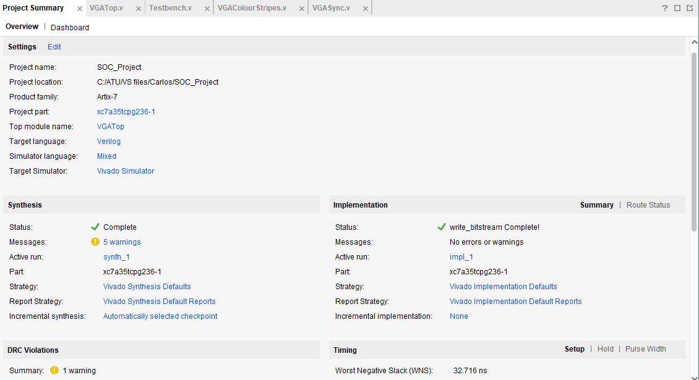
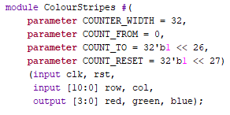

# FPGA VGA Driver Project

This project explores the development and modification of a VGA display driver using Verilog, Xilinx Vivado and the Digilent Basys 3 FPGA development board. Starting with a supplied VGA template, I experimented with different colour patterns before developing my own graphical designs. My final design is an 8 × 8 chessboard pattern, demonstrating how pixel coordinates and digital logic can be used to generate images on a 640 × 480 VGA display.
 

## **Template VGA Design**
### **Project Set-Up**
Summarise the project set-up and design flow. Include a screenshot of your own set-up, for example see the image of my Project Summary window below. Guideline 1 short paragraph.

The project was developed using Xilinx Vivado and the Digilent Basys 3 FPGA development board. The supplied VGA project template was used as the starting point for the design. The template contained Verilog source files responsible for generating the VGA timing signals, tracking the pixel coordinates and controlling the RGB colour outputs.

The project was configured in Vivado so that the design could be simulated, synthesised and implemented for the Basys 3 FPGA. This provided the foundation for understanding how the VGA display operates before modifying the original graphics logic.

### **Template Code**
Outline the structure and design of the Verilog code templates you were given. What do they do? Include reference to how a VGA interface works. Guideline: 2/3 short paragraphs, consider including screenshot(s).

The original design uses a verilog module called ColourStripes, which is responsible for generating the RGB colour values displayed on the VGA monitor. The module receives a clock signal (clk), a reset signal (rst) and two 11-bit inputs called row and col. These inputs represent the current vertical and horizontal pixel coordinates on the display.

The module produces three 4-bit outputs for the red, green and blue colour channels. These RGB outputs determine the colour of each pixel displayed on the monitor. The use of 4 bits per colour channel allows 16 possible intensity levels each individual colour.

### **Simulation**
Explain the simulation process. Reference any important details, include a well-selected screenshot of the simulation. Guideline: 1/2 short paragraphs.
### **Synthesis**
Describe the synthesis and implementation processes. Consider including 1/2 useful screenshot(s). Guideline: 1/2 short paragraphs.
### **Demonstration**
Perhaps add a picture of your demo. Guideline: 1/2 sentences.

## **My VGA Design Edit**
Introduce your own design idea. Consider how complex/achievabble this might be or otherwise. Reference any research you do online (use hyperlinks).

For my own VGA design, I decided to adapt the original colour stripe template to create an 8 × 8 chessboard pattern. The aim was to use the existing VGA architecture on the Basys 3 FPGA board while modifying the Verilog code to generate a different image. I chose a chessboard because it allowed me to explore how pixel coordinates can be used to divide the screen into individual sections and generate alternating colours.

The chessboard is designed to contain 64 equally sized squares, with each square measuring 80 pixels horizontally and 60 pixels vertically. This allows the complete chessboard to fit within 640 x 480 VGA display resolution.

### **Code Adaptation**
Briefly show how you changed the template code to display a different image. Demonstrate your understanding. Guideline: 1-2 short paragraphs.

The original template used the column coordinate (col) to divide the 640 x 480 display into eight vertical stripes, each 80 pixels wide. It used a series of (if) and (else if) statements to check which section of the screen the current pixel belonged to. Each condition assigned a different combination of red, green and blue values.

To adapt this into a chessboard, i changed the colour selection logic so that it uses both row (row) and column (col) coordinates. I introduced two local parameters, (SQUARE_WIDTH) and (SQUARE_HEIGHT), set to 80 and 60. These divide the 640 x 480 screen into 64 equally sized squares. I then introduced the (square_col0 and (square_row) wires, which calculate which chessboard square the current pixel belongs to. An XOR(^) operation is used to alternate between black and white squares depending on the position.

### **Simulation**
Show how you simulated your own design. Are there any things to note? Demonstrate your understanding. Add a screenshot. Guideline: 1-2 short paragraphs.
### **Synthesis**
Describe the synthesis & implementation outputs for your design, are there any differences to that of the original design? Guideline 1-2 short paragraphs.
### **Demonstration**
If you get your own design working on the Basys3 board, take a picture! Guideline: 1-2 sentences.

## **More Markdown Basics**
This is a paragraph. Add an empty line to start a new paragraph.

Font can be emphasised as *Italic* or **Bold**.

Code can be highlighted by using `backticks`.

Hyperlinks look like this: [GitHub Help](https://help.github.com/).

A bullet list can be rendered as follows:
- vectors
- algorithms
- iterators

Images can be added by uploading them to the repository in a /docs/assets/images folder, and then rendering using HTML via githubusercontent.com as shown in the example below.

