# FPGA VGA Driver Project

This project explores the development and modification of a VGA display driver using Verilog, Xilinx Vivado and the Digilent Basys 3 FPGA development board. Starting with a supplied VGA template, I experimented with different colour patterns before developing my own graphical designs. My final design is an 8 × 8 chessboard pattern, demonstrating how pixel coordinates and digital logic can be used to generate images on a 640 × 480 VGA display.

## **Template VGA Design**
### **Project Set-Up**

The project was developed using Xilinx Vivado and the Digilent Basys 3 FPGA development board. The supplied VGA project template was used as the starting point for the design. The template contained Verilog source files responsible for generating the VGA timing signals, tracking the pixel coordinates and controlling the RGB colour outputs.

The project was configured in Vivado so that the design could be simulated, synthesised and implemented for the Basys 3 FPGA. This provided the foundation for understanding how the VGA display operates before modifying the original graphics logic.

### **Template Code**

The supplied Verilog code was used as the starting point for my VGA project. Before making any modifications, I investigated how the original `ColourStripes` module generated different colours across the display. I focused on understanding the module inputs and outputs, the combinational colour-generation logic and the registered RGB outputs. This helped me understand how the original design worked and provided a foundation for developing my own graphical patterns.

**MODULE INPUTS AND OUTPUTS**

The original design uses a verilog module called ColourStripes, which is responsible for generating the RGB colour values displayed on the VGA monitor. The module receives a clock signal (clk), a reset signal (rst) and two 11-bit inputs called row and col. These inputs represent the current vertical and horizontal pixel coordinates on the display.

The module produces three 4-bit outputs for the red, green and blue colour channels. These RGB outputs determine the colour of each pixel displayed on the monitor. The use of 4 bits per colour channel allows 16 possible intensity levels each individual colour.

**ORIGINAL COLOUR GENERATION LOGIC**

The original template uses a combinational always@* block to determine the RGB colour values based on the current column coordinate (col). A series of if and else if statements checks which horizontal section of the display the current pixel belongs to.

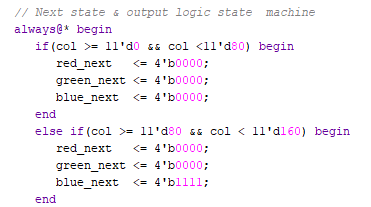

The 640-pixel horizontal display is divided into eight sections, each 80 pixels wide. Each section is assigned a different RGB combination to produce a vertical colour stripe, for example, the first section uses zero values for all three colour channels, producing black, while the second section sets the blue channel to its maximum value, producing blue.

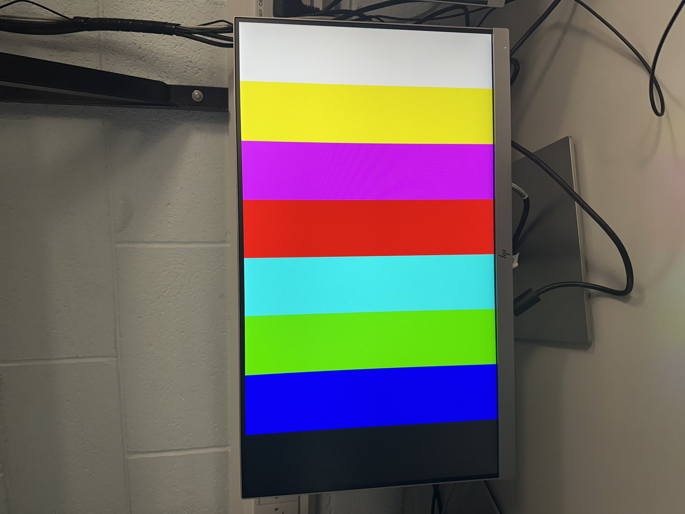

This approach demonstrates how pixel coordinates can be used to divide a VGA display into separate regions and generate different colours.

**RGB REGISTERS AND RESET**

The RGB outputs are registered using a clocked always block. The block is triggered by either the rising edge of the clock or the rising edge of the reset signal. This means the RGB registers update on each positive clock edge, while the reset can immediately clear the outputs.

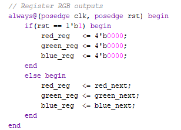

When reset is activated all three RGB registers are set to zero, producing black. Otherwise, the registers take the values calculated by the combinational colour generation logic, This separates the colour calculation from the registered outputs and ensures that the RGB signals are updated in a controlled manner.

**ASSIGNING THE RGB OUTPUTS**

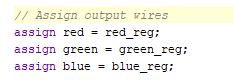

The final section of the module uses continuous assignments to connect the registered RGB values to the module outputs. This makes the calculated red, green and blue values available to the VGA display interface, The three outputs work together to determine the colour of the current pixel.

### **Simulation**

The original VGA design was simulated using the testbench supplied by the lecturer. I did not make any modifications to the testbench, as it already provided the necessary inputs to test the functionality of the ColourStripes module.

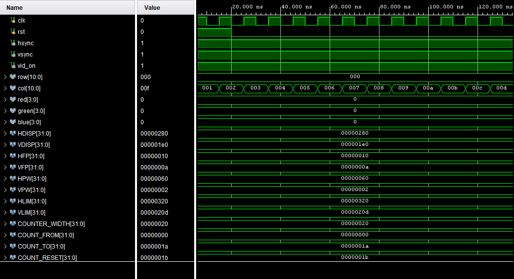

By observing the RGB outputs as the column coordinate changed, I could verify how the design selected different colours for each of the eight horizontal sections of the display. This allowed me to check the behaviour of the original Verilog code before making any modifications to the design.

### **Synthesis**

After successfully simulating the original VGA design, I proceeded to synthesise the Verilog code using Vivado. The purpose of synthesis is to convert the Verilog description into a hardware representation that can be implemented on the FPGA, During this process, Vivado analyses the design and determines which FPGA resources are required to implement its functionality. These include Look-Up Tables (LUTs), which are used to implement combinational logic, and flip-flops, which store values and implement sequential logic.

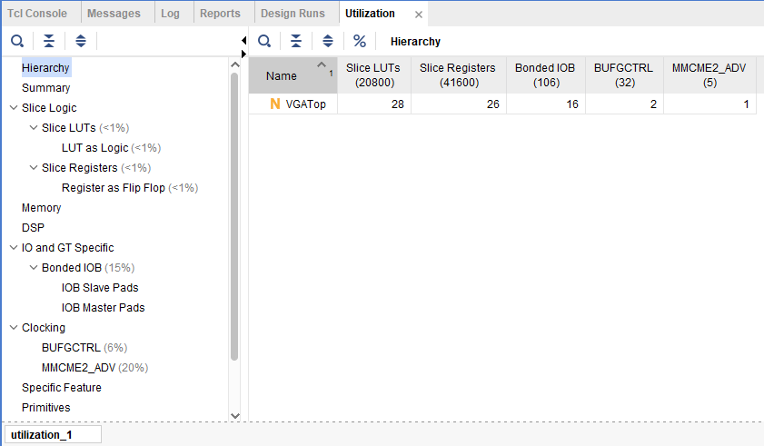

### **Demonstration**

After completing the simulation, synthesis and implementation stages in vivado, I programmed the original VGA design onto the Digilent Basys 3 development board. The board was connected to a VGA-compatible monitor to check that the design operated correctly on physical hardware.

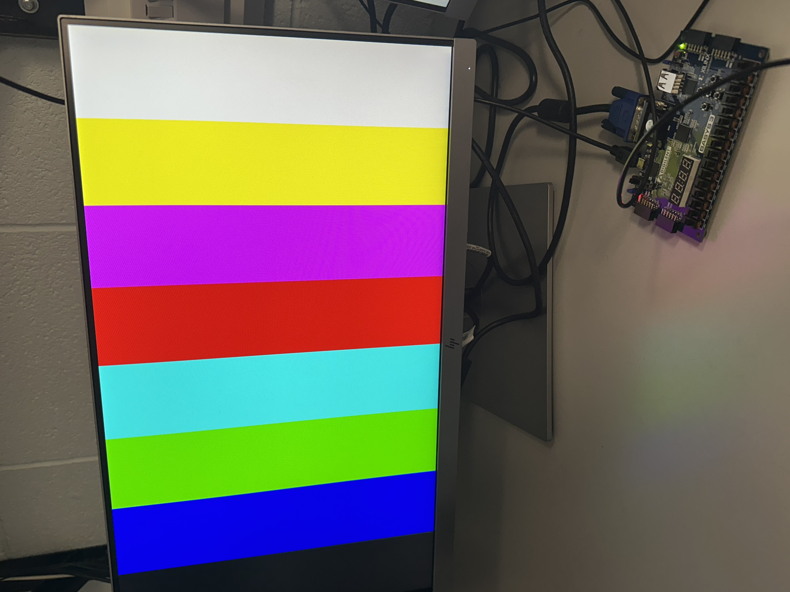

This demonstration allowed me to verify that the original Verilog design could generate a VGA display output using the FPGA. Successfully demonstrating the supplied design provided a starting point for developing and testing my own graphical patterns.

## **My VGA Design Edit**

After successfully demonstrating the original VGA template, I began experimenting with the Verilog colour-generation logic to create my own graphical designs. I wanted to develop my understanding of how pixel coordinates could be used to divide the display into different regions and generate more complex images.

I approached this development in stages, starting with a simple horizontal red and black colour split. I then progressed to a multicoloured chessboard pattern before developing my final black-and-white 8 × 8 chessboard. Each stage allowed me to experiment with the existing VGA architecture and build upon my understanding of Verilog and FPGA design.

### **Development Stage 1**

**HORIZONTAL RED AND BLACK PATTERN**

My first modification to the original VGA template was to create a simple horizontal colour pattern. I wanted to understand how the pixel coordinates could be used to divide the display into separate regions and assign different colours to them.

I used the vertical pixel coordinate (row) to divide the 640 × 480 display into two equal sections. The upper half of the screen displayed red, while the lower half displayed black. This was achieved by checking whether the current row coordinate was above or below the halfway point of the display.

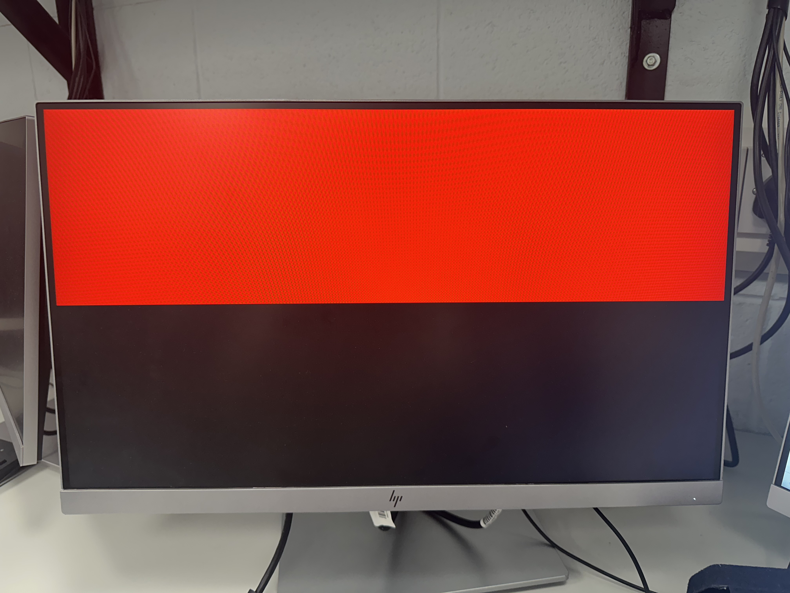

This was my first step towards developing my own VGA graphics. It helped me understand how conditional statements could be used in Verilog to control the RGB outputs based on the position of each pixel.

### **Development Stage 2**

**MULTICOLOURED CHESSBOARD**

After completing the horizontal colour pattern, I decided to make the design more complex by introducing a chessboard-style image. Instead of displaying just two large sections, I wanted to divide the screen into smaller squares with alternating colours.

In this version, the upper half of the display contained alternating red and yellow squares, while the lower half contained alternating black and blue squares. This created a more detailed image and required the colour-generation logic to consider the position of the pixels in both directions.

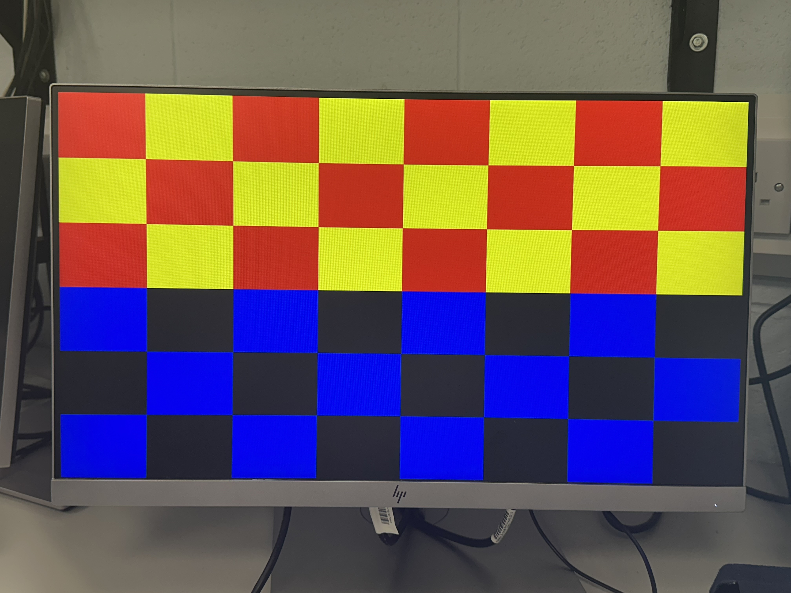

Developing this design helped me explore how horizontal and vertical pixel positions could be combined to generate a two-dimensional graphical pattern. It also provided a stepping stone towards my final black-and-white chessboard design.

### **Development Stage 3** 

**Final Black-and-White Chessboard**

For my final design, I decided to develop a traditional black-and-white chessboard consisting of eight rows and eight columns. I chose this design because it allowed me to explore how mathematical calculations and logical operations could be used to generate a complete graphical pattern.

The display resolution is 640 × 480 pixels, so I divided the screen into 64 equally sized squares. Each square measures 80 pixels horizontally and 60 pixels vertically. This ensures that eight squares fit across the width and eight squares fit down the height of the display.

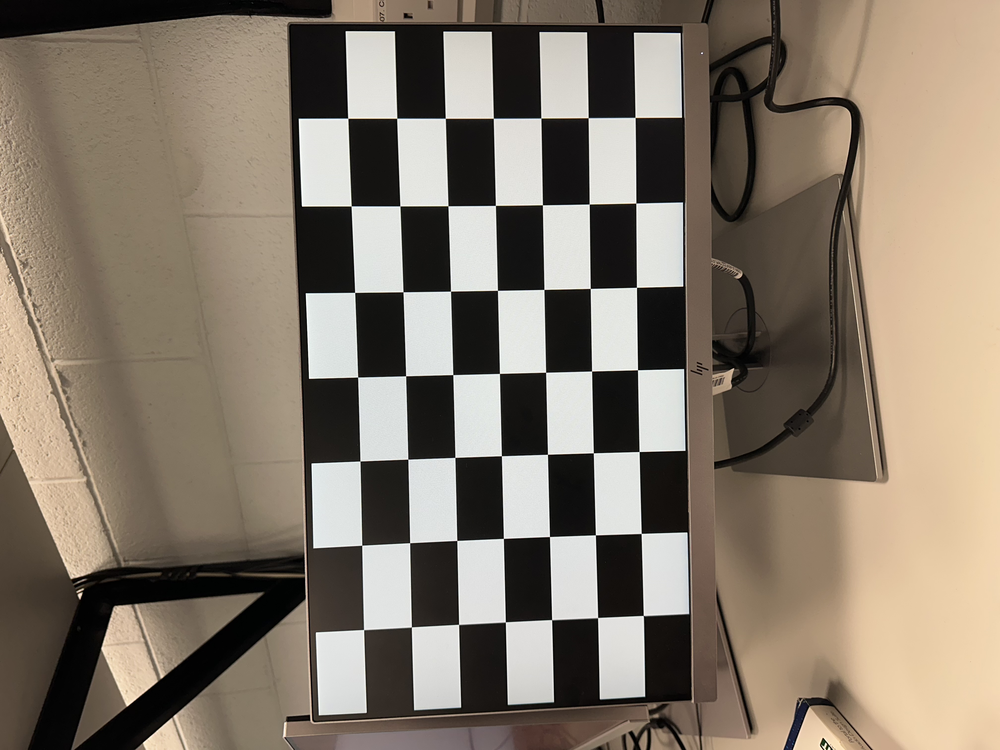

I used the horizontal (`col`) and vertical (`row`) pixel coordinates to calculate which square was currently being displayed. An XOR operation was then used to alternate between black and white squares. This allowed me to generate the complete chessboard using a small amount of Verilog code instead of writing individual conditions for all 64 squares.

### **Code Adaptation**

**CHESSBOARD DIMENSIONS**

I introduced two local parameters called `SQUARE_WIDTH` and `SQUARE_HEIGHT` to define the dimensions of each chessboard square. These were set to 80 and 60 pixels respectively.

I selected these dimensions because the VGA display has a resolution of 640 × 480 pixels. Dividing the horizontal resolution by 80 gives eight columns, while dividing the vertical resolution by 60 gives eight rows. This produces a complete 8 × 8 chessboard containing 64 equally sized squares.

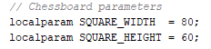

Using local parameters also makes the design easier to modify because the square dimensions can be changed without rewriting the coordinate calculations.

**PIXEL COORDINATE CALCULATIONS**

To identify which chessboard square was being displayed, I introduced two wires called `square_col` and `square_row`. These calculate the horizontal and vertical square positions by dividing the current pixel coordinates by the corresponding square dimensions.

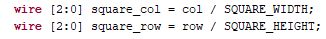

For example, if the current column coordinate is 170, dividing it by 80 gives a square column index of 2. Similarly, a row coordinate of 130 divided by 60 gives a square row index of 2.

The resulting values identify the position of the current pixel within the 8 × 8 chessboard. The three-bit width is sufficient because each coordinate can represent eight possible square positions, numbered 0 to 7.

**XOR COLOUR SELECTION**

I used an XOR operation to generate the alternating chessboard pattern. The operation compares the least significant bits of the horizontal and vertical square indices.

When the two bits are different, the XOR output is 1. When they are the same, the output is 0. This produces an alternating pattern because neighbouring squares have different parity values.

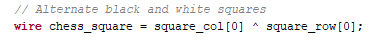

The resulting 'chess_square' signal is used by the colour-generation logic to decide whether the current square should be black or white. This approach is more efficient and easier to maintain than writing separate conditional statements for all 64 squares.

### **Simulation**

After completing my black-and-white chessboard design, I used Xilinx Vivado to simulate the modified Verilog code. I used the testbench supplied by the lecturer without making any modifications, allowing me to test my adapted design using the original simulation environment.

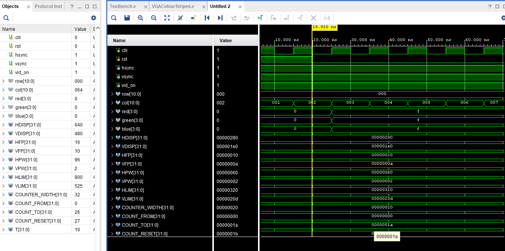

The simulation allowed me to verify the coordinate calculations and XOR logic used to generate the alternating chessboard pattern. The RGB outputs were assigned maximum values (1111) for white squares and zero values (0000) for black squares. Successfully completing the simulation gave me confidence that the modified design was behaving as expected before moving on to synthesis and hardware implementation.

### **Synthesis**

After successfully simulating my final chessboard design, I proceeded to synthesise the modified Verilog code using Xilinx Vivado. The synthesis process converted my Verilog design into a hardware representation that could be implemented on the Basys 3 FPGA development board.

Compared with the original template, my final design contained additional logic to calculate the position of each chessboard square. This included the use of the horizontal and vertical pixel coordinates, division by the square dimensions and an XOR operation to generate the alternating black-and-white pattern.

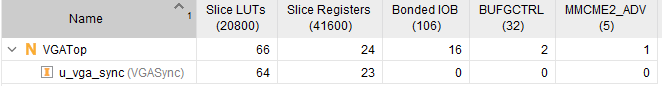

Once synthesis had completed successfully, I proceeded with the implementation stage. Vivado performed placement and routing to prepare the design for programming onto the FPGA. The implementation completed successfully, allowing me to move forward with the physical hardware demonstration.

### **Demonstration**

After successfully completing the simulation, synthesis and implementation stages, I programmed my final chessboard design onto the Digilent Basys 3 FPGA development board. I connected the board to a VGA monitor to test the design using physical hardware.

The demonstration was successful, with the complete black-and-white 8 × 8 chessboard displaying correctly on the monitor. This confirmed that my modified Verilog code was working as intended and that the FPGA could generate the required graphical pattern using the VGA interface.

Successfully demonstrating the final design was the final stage of my development process and showed that I could adapt the supplied VGA template to create my own working graphical output.

## **More Markdown Basics**
This is a paragraph. Add an empty line to start a new paragraph.

Font can be emphasised as *Italic* or **Bold**.

Code can be highlighted by using `backticks`.

Hyperlinks look like this: [GitHub Help](https://help.github.com/).

A bullet list can be rendered as follows:
- vectors
- algorithms
- iterators

Images can be added by uploading them to the repository in a /docs/assets/images folder, and then rendering using HTML via githubusercontent.com as shown in the example below.

